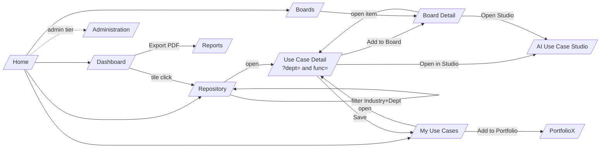
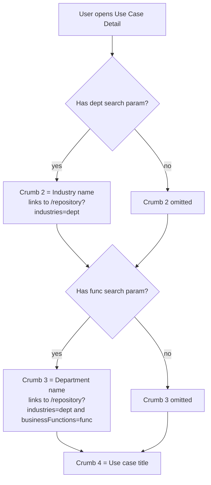
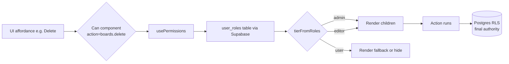

# UseCasesX™ — UI & Navigation Map

> Companion to `UseCasesX-Project-Overview.md`. This document captures every
> user-facing route, the filters/breadcrumbs it supports, and the role tier
> required for each action under the new **admin / editor / user** model.
>
> Updated: June 6, 2026.

---

## 1. Role tiers (recap)

Layered on top of the existing 9-role taxonomy via `src/lib/permissions.ts`:

| Tier   | Underlying `app_role` values                                                            | Intent                          |
| ------ | --------------------------------------------------------------------------------------- | ------------------------------- |
| admin  | `admin`, `super_admin`, `ai_hub_admin`, `usecasex_admin`                                | Full control + admin panel       |
| editor | `editor`, `moderator`, `content_manager`, `reviewer`, `contributor`                     | Create / edit shared content    |
| user   | everyone else (incl. `viewer`, `user`, no role)                                         | Save / view, own boards only    |

UI gating uses `<Can action="…">…</Can>` (see `src/components/Can.tsx`).
Database authority remains RLS — UI gates are convenience, not security.

### Action matrix

| Action              | admin | editor | user |
| ------------------- | :---: | :----: | :--: |
| `repo.view`         |  ✅   |   ✅   |  ✅  |
| `repo.save`         |  ✅   |   ✅   |  ✅  |
| `repo.create`       |  ✅   |   ✅   |  —   |
| `repo.edit`         |  ✅   |   ✅   |  —   |
| `repo.delete`       |  ✅   |   —    |  —   |
| `dashboard.view`    |  ✅   |   ✅   |  ✅  |
| `dashboard.export`  |  ✅   |   ✅   |  ✅  |
| `saved.view/create/edit/delete` (own) | ✅ | ✅ | ✅ |
| `boards.view`       |  ✅   |   ✅   |  ✅  |
| `boards.create`     |  ✅   |   ✅   |  ✅  |
| `boards.edit`       |  ✅   |   ✅   |  —   |
| `boards.delete`     |  ✅   |   ✅   |  —   |
| `boards.addItem`    |  ✅   |   ✅   |  ✅  |
| `boards.removeItem` |  ✅   |   ✅   |  —   |
| `admin.taxonomy`    |  ✅   |   —    |  —   |
| `admin.users`       |  ✅   |   —    |  —   |

---

## 2. Page-by-page map

Search-param conventions used throughout:

- `q` – free-text search
- `industries[]`, `industry` – Industry filter (primary tag, legacy single also supported)
- `businessFunctions[]` – Department filter (Business Function)
- `dept` – Industry context carried into detail/board links
- `func` – Department context carried into detail/board links
- `sort` – one of `relevant | value | complexity | risk | ttv | newest`

### 2.1 Repository — `/repository`

| Aspect        | Detail |
| ------------- | ------ |
| Purpose       | Browse the global AI use-case catalogue |
| Filters       | Industry, AI Type, Business Function (Department), Objective, Maturity, Value, Complexity, Risk, Time-to-Value, Sector, Tag |
| Sort          | Most relevant · Highest value · Lowest complexity · Lowest risk · Fastest TTV · Newest |
| Breadcrumb    | `Home › Repository` |
| Actions       | View (`repo.view`) · Save to My Use Cases (`repo.save`) · Add to Studio Board (`boards.addItem`) · Request custom pack (lead form) |
| Editor only   | "Submit new pattern" CTA (`repo.create`) |
| Admin only    | Inline edit + hard-delete on each card (`repo.edit` / `repo.delete`) |

### 2.2 Use Case Detail — `/use-cases/$slug?dept=&func=`

| Aspect      | Detail |
| ----------- | ------ |
| Breadcrumb  | `Repository › {Industry} › {Department} › {Title}` — each crumb deep-links back into `/repository` with the matching `industries[]` / `businessFunctions[]` filter applied |
| Tabs        | Overview · Data · Governance · Cybersecurity · ROI · Blueprint · Feedback |
| Actions     | Save (`repo.save`) · Add to Board (`boards.addItem`) · Open in Studio · Download PDF · Share |
| Editor only | "Edit pattern" → admin form |
| Admin only  | Publish/unpublish toggle, delete |

### 2.3 Saved Use Cases / My Use Cases — `/my-use-cases?dept=&func=`

| Aspect      | Detail |
| ----------- | ------ |
| Purpose     | Personal shortlist with priorities, notes, scoring, portfolio assignment |
| Filters     | Priority, Industry (carries `dept`), Department (`func`), Score range |
| Breadcrumb  | `Home › My Use Cases` (when arriving from a detail page: `My Use Cases › {Industry} › {Department}`) |
| Actions     | Edit note/priority (`saved.edit`, own rows) · Remove (`saved.delete`, own rows) · Score · Add to Portfolio · Open detail (preserves `dept`/`func`) |
| Role notes  | All tiers; RLS restricts to `auth.uid()` rows |

### 2.4 Dashboard — `/dashboard`

| Aspect     | Detail |
| ---------- | ------ |
| Purpose    | Pro overview: KPIs, quick wins, strategic bets, risk, readiness, reports |
| Filters    | Industry quick-pill, Department quick-pill (both forward to `/repository` as `industries[]` / `businessFunctions[]`) |
| Breadcrumb | `Home › Dashboard` |
| Actions    | Open any tile → filtered Repository · Export executive PDF (`dashboard.export`) · Jump to Boards / Portfolios |

### 2.5 Boards — `/boards` and `/boards/$boardId`

| Aspect              | Detail |
| ------------------- | ------ |
| Purpose             | Workspace-scoped collections of AI use cases (Supabase-backed) |
| List filters        | Status (active/archived), Type, Industry mix |
| Detail breadcrumb   | `Home › Boards › {Board title}` — items inside link to `/use-cases/$slug?dept=…&func=…` preserving Industry/Department |
| User actions        | View · Create board (`boards.create`) · Add items (`boards.addItem`) |
| Editor actions      | Rename/edit board (`boards.edit`) · Remove items (`boards.removeItem`) · Delete board (`boards.delete`) |
| Admin actions       | Same as editor, plus cross-workspace visibility |

### 2.6 Admin Surface — `/administration` (admin tier only)

Taxonomy editor, role assignment, audit log, feature flags. Gated by
`admin.taxonomy` / `admin.users`.

---

## 3. Navigation flow

## 4. Breadcrumb decision tree

## 5. Permission gate flow

---

## 6. Implementation pointers

- `src/lib/permissions.ts` — single source of truth for action → tiers
- `src/components/Can.tsx` — declarative UI gate
- `src/components/RequireRoles.tsx` — route-level gate (existing, still used for admin pages)
- `src/lib/usecasex.roles.ts` — `useRoles()` hook + `AppRole` union
- Database enum `public.app_role` now includes `admin`, `editor`, `user`
  alongside legacy values; existing role assignments untouched.
