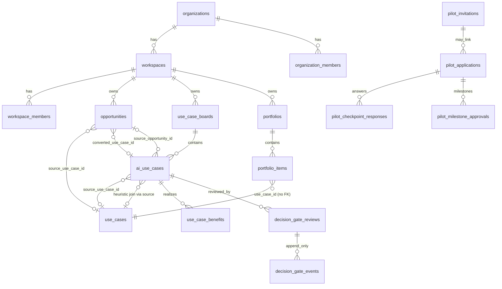
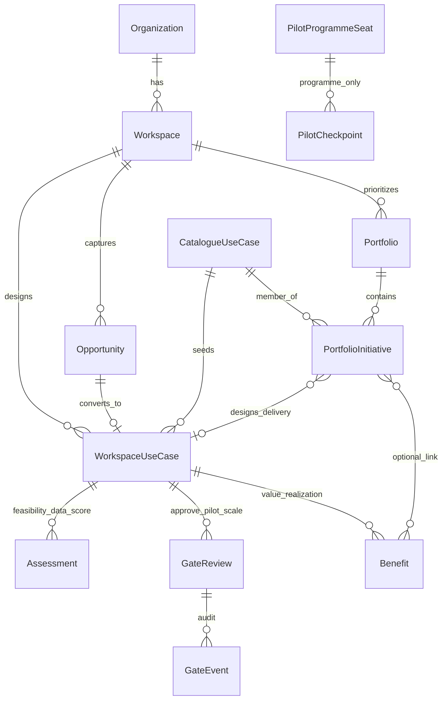

# UseCasesX™ domain-model review

**Status:** Read-only review — **no schema changes** in this task.  
**Date:** 2026-10-12  
**Sources:** `src/integrations/supabase/types.ts`, `supabase/migrations/*` (V2 additive set), `src/lib/{opportunities,portfolio-model,value/benefits.model,lifecycle,gates}/**`, domain repositories, Studio / portfolio / pilot routes.  
**Related:** `docs/v2/lifecycle-status-map.md`, `docs/architecture/domain-boundaries.md`, `docs/architecture/tenancy-migration-plan.md`.

---

## Executive summary

The product already encodes most of the intended journey, but **five business objects are not named consistently in the schema**:

| Business object (desired) | Closest persistence today | Clarity |
| ------------------------- | ------------------------- | ------- |
| **Opportunity** | `opportunities` | Clear |
| **AI Use Case** | Split: catalogue `use_cases` vs workspace `ai_use_cases` | Ambiguous naming / dual track |
| **Portfolio Initiative** | No table; behavior lives on `portfolio_items` inside `portfolios` | Partial — container ≠ initiative |
| **Pilot / Implementation** | Product **pilot programme** tables (`pilot_*`) ≠ use-case **implementation pilot**; gates + roadmap fields cover delivery intent | Overloaded word “Pilot” |
| **Value Realization** | `use_case_benefits` (+ ERP verification fields) | Clear enough; weakly linked to portfolio delivery |

Canonical lifecycle states exist in application code (`src/lib/lifecycle`) and map many status dialects, but **entities still store their own status strings** — there is no single persisted “current lifecycle state” column shared across objects.

---

## A. Current entities

### A1. Tenancy (context for everything else)

| Table | Role |
| ----- | ---- |
| `organizations` | Tenant (plan / entitlements / SSO) |
| `workspaces` | Portfolio of work inside an org |
| `organization_members`, `workspace_members` | Membership + roles |
| `organization_units` | Org structure (optional linkage) |
| `plans`, `entitlements` | Commercial / capability bounds |
| `user_roles` | Platform staff roles (separate from workspace roles) |

### A2. Opportunity (pre-solution problem)

| Artifact | Detail |
| -------- | ------ |
| Table | `opportunities` |
| Ownership | `workspace_id` NOT NULL; optional `organization_id` |
| Status enum | `signal` → `opportunity` → `qualified` → `converted` / `deferred` / `archived` |
| Lineage out | `converted_use_case_id` → `ai_use_cases` |
| Lineage in | optional `source_use_case_id` → catalogue `use_cases` |
| TS model | `src/lib/opportunities.ts` |
| API | `src/lib/opportunities.functions.ts` / `.server.ts` |
| UI | `/opportunities`, `/opportunities/new`, `/opportunities/$id` |

**Verdict:** Distinct and well-documented. Conversion creates a Studio draft and freezes opportunity status to `converted`.

### A3. AI Use Case — dual track

| Track | Table | Meaning |
| ----- | ----- | ------- |
| **Catalogue / Repository** | `use_cases` (+ taxonomy link tables) | Published, curated (or submitted) content for Discover |
| **Workspace Studio work item** | `ai_use_cases` | Tenant-owned design artifact; requires `board_id` → `use_case_boards` |

Key Studio columns: `status`, `source_opportunity_id`, `source_use_case_id`, `workspace_id`, canvas fields, `wizard_state`, assessments via related tables (`feasibility_scores`, `data_readiness_assessments`, `blueprints`, `scorecard_results`, deliverables, versions).

Also nearby:

| Table | Role |
| ----- | ---- |
| `saved_use_cases` | User bookmark of catalogue rows |
| `use_case_submissions` | Community/CMS submit path into catalogue |
| `use_case_versions` | Versioned studio/canvas snapshots |
| `shortlists`, `collections` | Curation aids |

**Verdict:** The **business** “AI Use Case” is primarily `ai_use_cases`. Catalogue `use_cases` is a **different bounded context** (content). The shared English name causes product and portfolio confusion.

### A4. Portfolio (container) vs initiative (membership)

| Table | Role |
| ----- | ---- |
| `portfolios` | Named container: objective, type, visibility, optional nesting (`parent_portfolio_id`), `workspace_id` / `organization_id` |
| `portfolio_items` | Membership of a **catalogue** `use_case_id` in a portfolio: `decision`, `funding_state`, `delivery_stage`, roadmap dates, `depends_on`, `rank`, notes |
| `portfolio_shares` | Token share links |

Important implementation note (`portfolios.repository.ts`):

> `portfolio_items.use_case_id` intentionally carries **no foreign key** — resolved against `use_cases`, with optional Studio draft via `ai_use_cases.source_use_case_id`.

There is **no** `portfolio_initiatives` (or similar) table. “Initiative” behavior (approve / fund / schedule / deliver) is **attributes of the membership row**.

**Verdict:** Portfolio *container* is clear. **Portfolio Initiative** as a first-class business object is **implicit** on `portfolio_items`.

### A5. Pilot / Implementation

Two different meanings collide on the word “pilot”:

| Meaning | Persistence | Product surface |
| ------- | ----------- | --------------- |
| **AIgilityX Pilot Programme** (seats, checkpoints, milestones for founding/design partners) | `pilot_applications`, `pilot_invitations`, `pilot_onboarding_profiles`, `pilot_checkpoint_responses`, `pilot_milestone_approvals`, `pilot_reminders`, `pilot_settings`, `pilot_verdict_snapshots`, … | `/pilot`, `/pilot/portal`, `/platform-admin/pilot*` |
| **Use-case implementation pilot** (authorize a designed use case to run a limited live trial) | Not a dedicated entity. Approximated by: decision gate `pilot_authorization`, canonical state `pilot` / `approved_pilot`, portfolio `delivery_stage` / `decision`, maturity taxonomy | Studio gates + roadmap |

**Verdict:** Product pilot programme is solid and separate. **Implementation pilot** is **not** a first-class domain object today.

### A6. Value realization

| Artifact | Detail |
| -------- | ------ |
| Table | `use_case_benefits` |
| FK | `use_case_id` → **`ai_use_cases`** |
| State | `proposed` → `approved` → `delivered` → `verified` → `sustained` |
| Model | `src/lib/value/benefits.model.ts` |
| Extras | Evidence links, measurement cadence, optional ERP verification fields |

Supporting: `use_case_scores` / scorecards (assessment of potential), ROI calculator route (mostly client-side, not a durable entity).

**Verdict:** Benefits are the right core for Measure / Value Realization. They attach to Studio drafts, not portfolio membership or catalogue rows.

### A7. Approval / governance / audit (cross-cutting)

| Concern | Persistence |
| ------- | ----------- |
| Decision gates | `decision_gate_reviews`, `decision_gate_events`, open conditions (V2-10 migration). Gate keys include `pilot_authorization`, `scale_authorization`. *(Present in migrations; not yet reflected in local `types.ts` snapshot — treat as schema-intent.)* |
| Collaboration review | `collab_review_states`, comments, assignments |
| Append-only audit | `audit_events`, `use_case_audit_log`, `pilot_audit_events`, `product_events` |
| Governance preview | Studio C3G route + related governance tables from V2-11 |
| Suite handoffs | `suite_handoff_requests` |

### A8. Journey stage coverage (as implemented)

| Stage | Primary objects today |
| ----- | --------------------- |
| Discover | Catalogue `use_cases`, `/repository`, `/discover`, patterns |
| Design | `ai_use_cases`, boards, wizard, solution-design |
| Assess | Feasibility, data readiness, scorecards, ROI UI |
| Prioritize | Portfolios + `portfolio_items.rank` / roadmap lanes |
| Approve | Decision gates, portfolio `decision`, collab review |
| Pilot | Gate `pilot_authorization` + programme `pilot_*` (different concept) |
| Scale | Gate `scale_authorization`, maturity / handoff lifecycle labels |
| Measure | `use_case_benefits` states `verified` / `sustained` |

---

## B. Entity overlap

1. **`use_cases` vs `ai_use_cases`** — both called “use case”; different ownership, status dialects, and consumers. Portfolio points at catalogue; benefits/gates point at Studio.
2. **Opportunity vs Studio “idea”** — both can represent early problem framing; conversion links them, but parallel capture paths (scratch Studio, workshop, submission) can bypass Opportunity.
3. **Portfolio `decision` vs Gate review status vs Studio `status` vs Benefit `state`** — four approval-ish vocabularies that can disagree for the same business initiative.
4. **Roadmap delivery (`delivery_stage`, `roadmap_status`) vs Gate `pilot_authorization` / `scale_authorization`** — delivery intent vs formal authorization not formally linked (optional `gate_key` on roadmap patch is informational).
5. **Product Pilot vs Implementation Pilot** — shared English label; separate data; high CV / UX confusion risk.
6. **Catalogue content status vs Studio lifecycle** — `content_status` / publish pipeline vs workspace design status; both map into the same canonical map for reporting only.

---

## C. Missing relationships

| Gap | Why it matters |
| --- | -------------- |
| No FK `portfolio_items.use_case_id` → `use_cases` | Integrity / orphan memberships; intentional today for flexibility |
| No direct `portfolio_items` → `ai_use_cases` | Studio handoff is **heuristic** via `source_use_case_id` |
| No entity for “implementation / delivery record” | Pilot→Scale→Measure lacks a single row to hang dates, owner, KPIs, evidence |
| Benefits not linked to `portfolio_items` | Value tracked on Studio draft; portfolio “delivered” may not align with verified benefits |
| Opportunity not required before Studio | Valid for repo-seeded drafts; weakens Discover→Design lineage when skipped |
| Canonical lifecycle not persisted | Mapping is code-side; hard to query “all measuring initiatives” across tables |
| Decision-gate tables absent from generated client types (snapshot) | Indicates types drift or incomplete client generation — integration risk for API consumers |

---

## D. Ambiguous status fields

| Location | Values (summary) | Ambiguity |
| -------- | ---------------- | --------- |
| `opportunities.status` | signal…converted | Clear *within* Opportunity; maps into Design when converted |
| `ai_use_cases.status` | string (wizard/studio dialects) | Overlaps with gates and portfolio decisions |
| `use_cases.status` / `content_status` | publish workflow | Content ops ≠ workspace lifecycle |
| `portfolios.status` | Draft / Active / Archived (string casing varies) | Container health, not initiative state |
| `portfolio_items.decision` | under_review…delivered | Portfolio investment decision — not gate SoD |
| `portfolio_items.funding_state` | unfunded…on_hold | Parallel to decision |
| `portfolio_items.delivery_stage` | now/next/later/unscheduled | Sequencing lane, not lifecycle |
| `portfolio_items.roadmap_status` | planned…deferred | Execution status on membership |
| Gate review `status` | draft…rejected | Formal approval workflow |
| `use_case_benefits.state` | proposed…sustained | Value realization only |
| `use_case_boards.status` | operational | Explicitly unmapped (good) |
| Pilot invitation / milestone statuses | enrollment / evidence | Unmapped from use-case lifecycle (good) |

Canonical map (`src/lib/lifecycle/map.ts`) reduces reporting chaos but **does not prevent contradictory writes**.

---

## E. Data migration risks (if clarifying the model later)

**Do not run these now** — inventory only.

| Risk | Notes |
| ---- | ----- |
| Renaming `ai_use_cases` / `use_cases` | Breaks every Studio, benefit, gate, board FK; requires dual-write window |
| Adding NOT NULL FKs on `portfolio_items.use_case_id` | Orphans / non-UUID historical rows; soft-FK first |
| Introducing `portfolio_initiatives` as new table | Must backfill 1:1 from `portfolio_items` or redefine items as joins |
| Unifying status columns onto canonical enum | Silent coercion forbidden by V2 rules; need explicit mapping + unmapped quarantine |
| Binding benefits to catalogue ids | Benefits today reference Studio ids; wrong join would hide value |
| Collapsing product `pilot_*` into implementation | Would destroy programme evidence; keep namespaces separate |
| Types drift (`decision_gate_*` missing from `types.ts`) | Client/API codegen must catch up before external API contracts |

Additive-safe directions (preferred): nullable FKs, new optional tables, views/materialized “initiative” projections, dual-write of `canonical_state` — consistent with repo migration rules.

---

## F. Recommended target domain model

### F1. Principles (do not over-engineer)

1. Keep **five business nouns** stable in product language even if table names stay for a while.
2. Prefer **clarifying relationships and projections** over renaming core tables in the launch window.
3. One **authoritative status per concern**; other statuses remain subordinate.
4. Persist **lineage**, not duplicate copies of the same fact.
5. Product Pilot Programme stays a **platform/engagement** domain — rename UI copy if needed (“Founding Pilot”), do not merge with implementation.

### F2. Bounded contexts

```text
Content (Catalogue)     Tenant Work               Engagement (optional)
use_cases               opportunities             pilot_* (programme)
taxonomies              ai_use_cases              invitations / seats
submissions             boards / assessments
                        portfolios + items
                        gates / benefits
```

### F3. Target objects (logical)

| Logical entity | Backing (near-term) | Authoritative status | Notes |
| -------------- | ------------------- | -------------------- | ----- |
| **Opportunity** | `opportunities` | `opportunity.status` | Unchanged |
| **Catalogue Use Case** | `use_cases` | content/publish status | Never call this “initiative” |
| **Workspace Use Case** (AI Use Case) | `ai_use_cases` | Studio status **or** derived canonical | Design hub |
| **Portfolio** | `portfolios` | container status only | Multi-workspace via `workspace_id` |
| **Portfolio Initiative** | `portfolio_items` (**logical rename in docs/UI**) | `decision` + `funding_state`; delivery via roadmap fields | Optional later: promote to table if initiatives outgrow membership |
| **Implementation** | *Defer dedicated table* until Scale volume justifies it | Use gate outcomes + roadmap fields | Add `implementation_records` only if pilots need their own KPIs/evidence separate from benefits |
| **Value Realization** | `use_case_benefits` | `benefit.state` | Link optionally to initiative id when available |
| **Approval** | `decision_gate_*` | gate review status | SoD; drives Approve/Pilot/Scale |
| **Audit** | `audit_events` (+ specialized logs) | append-only | Keep |

### F4. Lifecycle ownership (recommended)

| Journey stage | Owns the “current stage” signal |
| ------------- | -------------------------------- |
| Discover | Catalogue / discovery tools |
| Design | Workspace Use Case |
| Assess | Assessments + scorecards on Workspace Use Case |
| Prioritize | Portfolio Initiative (`rank`, lane) |
| Approve | Decision gate (investment / pilot / scale) |
| Pilot | Gate `pilot_authorization` approved + initiative delivery stage |
| Scale | Gate `scale_authorization` |
| Measure | Benefits in evidenced states |

Optional additive column later: `canonical_state` on Workspace Use Case **and/or** Portfolio Initiative, updated only through `src/lib/lifecycle/apply.ts` (never free-form UI writes).

### F5. Relationship rules (target)

```text
Opportunity 1──0..1→ Workspace Use Case
Catalogue Use Case 0..*←──saved / sourced──→ Workspace Use Case
Portfolio 1──* Portfolio Initiative (item)
Portfolio Initiative *──1 Catalogue Use Case   (membership)
Portfolio Initiative 0..1── Workspace Use Case (explicit FK when known; stop relying only on source heuristic)
Workspace Use Case 1──* Benefit
Workspace Use Case 1──* Gate Review
```

### F6. Enterprise / API readiness (minimal)

Already aligned or cheap to keep:

- Org + multi-workspace tenancy columns  
- Append-only audit / product events  
- Gate SoD model  
- Benefits with verification hooks  
- Portfolio nesting + visibility  

Defer until needed:

- Separate `implementations` table  
- Full PPM (tasks/sprints) — explicitly out of scope (`portfolio-model.ts` already says so)  
- Merging catalogue + studio into one polymorphic table  

### F7. Naming recommendations (product / API, not necessarily DB)

| Prefer saying | Avoid saying |
| ------------- | ------------ |
| Catalogue entry / Repository use case | “The use case” when meaning portfolio membership |
| Studio use case / Workspace use case | Ambiguous “AI use case” without qualifier |
| Portfolio initiative (or “portfolio entry”) | “Portfolio” when meaning one funded item |
| Founding / Design Partner Pilot | “Pilot” when meaning `/pilot` programme |
| Implementation pilot / live trial | Same word as programme seats |
| Benefit / value realization | “ROI” alone (calculator ≠ sustained value) |

---

## Mermaid ERD — current (simplified)



## Mermaid ERD — recommended logical model



---

## Alignment checklist vs required capabilities

| Requirement | Current fit | Recommendation |
| ----------- | ----------- | -------------- |
| Enterprise portfolios | Yes (`portfolios`, nesting, visibility) | Keep; URL-scope workspace |
| Multiple workspaces | Yes | Keep RLS as authority |
| Approval workflows | Yes (gates + portfolio decision) | Make gate authoritative for Approve/Pilot/Scale |
| Governance | Preview + handoffs + gates | Keep suite links contextual to Workspace Use Case |
| ROI / value tracking | Benefits strong; ROI calculator weak as entity | Persist calculator outputs into benefits/scorecards |
| Pilot tracking | Programme yes; implementation thin | Clarify copy; use gates + roadmap until volume needs a table |
| Auditability | `audit_events` + gate events | Keep append-only; emit on lifecycle.apply |
| Future API integration | Server fns / public routes exist | Publish stable resource names from §F7; regenerate types |

---

## Suggested next prompts (no schema work implied)

1. **Glossary PR** — adopt §F7 names in UI/docs only.  
2. **Initiative projection** — read model / TypeScript type `PortfolioInitiative` aliasing `portfolio_items` without migration.  
3. **Explicit Studio link on portfolio items** — nullable `studio_use_case_id` column (additive) when ready.  
4. **Types regen** — ensure `decision_gate_*` appear in `types.ts`.  
5. **Defer** `implementations` table until Measure/Pilot reporting cannot be answered from benefits + gates + roadmap.

---

## Conclusion

UseCasesX **does** distinguish Opportunity, Workspace Use Case, Portfolio container, Value (benefits), and Approvals (gates) in data — but **Portfolio Initiative** and **Implementation Pilot** are underspecified or overloaded, and **two “use case” tables** blur the model. The lean path is: keep tables, fix language and relationships, treat `portfolio_items` as initiatives in the domain layer, keep product `pilot_*` separate, and only add an Implementation entity if Scale/Measure outgrows benefits + gates.
