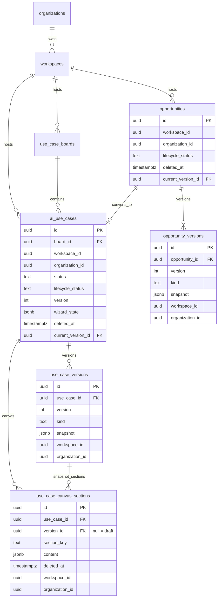

# UseCasesX™ V2 — Core ERD (V2-04)

**Date:** 2026-09-23  
**Companion:** [`data-dictionary.md`](./data-dictionary.md)

## Adapt vs create

| Keep / adapt | New in V2-04 | Deferred |
|--------------|--------------|----------|
| `opportunities`, `ai_use_cases`, `use_case_versions` | `opportunity_versions`, `use_case_canvas_sections`, `studio-canvas` bucket | evidence, scorecard versions, decisions, value contracts, agents |

## Workshop canvas (unchanged SoR)

`workshop_public_value_canvas`, `workshop_canvas_versions`, `workshop_canvas_documents` remain the workshop path. Studio Canvas V2 uses `use_case_canvas_sections` — same product, different bounded context; no rename.
